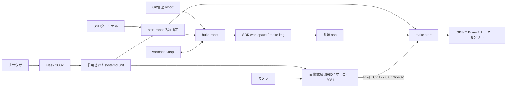

# 現状構成と調査範囲

調査日: 2026-10-26。対象: `ise-nituc/raspike-spike-demo` の `bb0c4efc0879299ff7d77fcfa7032bbbd67800f1`。本書はリポジトリの静的調査であり、Pi上の配置、導入済みunit、SDK、モーターの実動作は未確認。実装・設定は変更していない。

第2回の方針: ブラウザとの通信断では自動停止せず、Heartbeat/leaseを走行条件にしない。機体のフォースセンサー切替を必須とし、Pi内の画像/制御指令更新停止・Python–C通信断の安全停止とは分ける。以下は基準コミットの現状であり、この方針が実装済みという意味ではない。

設計文書の入口: [不整合一覧](inconsistencies.md)、[推奨ワークフロー](development-workflow-proposal.md)、[Web編集検討](web-editor-feasibility.md)、[移行計画](migration-plan.md)。後三者は未実装の提案であり、現行の安全保証ではない。

## 1. ソースと生成物

| アプリ | 名前指定ビルドの参照元 | ダッシュボードunit |
| --- | --- | --- |
| direct_pwm_camera | `robot/direct_pwm_camera/` | `raspike-direct-pwm-camera.service` |
| line_trace_camera | `robot/line_trace_camera/` | `raspike-line-trace-camera.service` |
| ocan2026 | `robot/ocan2026/` | `raspike-ocan2026.service` |
| appdir（互換用） | SDK workspaceの`appdir`指定 | 登録なし |

根拠: [build-robot](../../scripts/build-robot) L34–45、L93–99、[unitテンプレート](../../dashboard/systemd/)。`REPO_DIR`はスクリプト位置から求める。SDKは実行ユーザーの`$HOME/RasPike-ART/sdk/workspace`固定。名前は英数字・`_`・`-`に制限されるが、SDKやソースの版を固定する仕組みではない。

名前指定の場合、workspaceからソースへの相対パスを`realpath --relative-to`で求め、`make img=<相対パス>`へ渡す。ソースのコピーやリンク作成は行わない。三つのアプリの`Makefile.inc`はアプリ内モジュールを指定する。SDKのMakefile本体はリポジトリに含まれず、`img`の内部処理・依存関係追跡・`asp`の更新保証は別途SDKの版と実機で確認する。

生成物は共通の`~/RasPike-ART/sdk/workspace/asp`一つ。アプリ選択、Gitブランチ切替、ソース保存だけでは実行物は切り替わらない。`asp`はソースの正本ではない。

## 2. ビルドとキャッシュ

`build-robot` L21–24で`var/run/robot.lock`を`flock`する。通常アプリの処理は次のとおり。

1. workspaceに旧コピーの印`.raspike-spike-demo-source`があり、その内容が対象ソースの絶対パスと一致する場合だけ旧ディレクトリを削除する（L47–53）。印のないコピーや他のリンクを網羅的に移行する処理ではない。今回は実行していない。
2. 対象アプリ配下の通常ファイル全部を列挙・整列してSHA-256を計算する（L70–73）。README等も含み、`find`は通常シンボリックリンク先を再帰しない。
3. SDKのGit管理ファイルと非ignore未追跡ファイルの内容をハッシュする。workspace配下を除外し、`libraspike-art`がGit管理されていれば追加走査、再帰submodule状態とキャッシュ形式文字列を含める（L55–83）。
4. ソースとSDKのハッシュからキーを求める。`var/cache/asp/<key>/asp`が実行可能ならworkspaceの`asp`にコピーし、workspaceの`appdir`へソース絶対パスを書き込む（L87–91）。この`appdir`はコード上は書込み先ファイルであり、「編集用ディレクトリ」と決めつけられない。
5. missなら`building`状態を書き、`make img=...`成功後に`asp`と`application/source_hash/sdk_hash`を一時ディレクトリへ保存し、renameでキャッシュを公開する（L95–108）。

`appdir`分岐は`make img=appdir`だけを実行して終了し、このキャッシュを経由しない。引数なしの`build-robot`もこの分岐になる。

キャッシュはコンパイラ版・外部ライブラリ・環境変数・SDKのignoreファイル等の完全な再現性を証明しない。ソースとSDKをハッシュ後に編集すると、実際にビルドした内容とのずれも起こり得る。hit時は実行可能属性を検査するだけで、保存時のバイナリダイジェスト検証はない。make成功後に新しい`asp`が確実に生成されたかをスクリプト独自には検証していない。これらは設計上の限界であり、破損や誤動作を実機で観測したという意味ではない。

## 3. 実行・停止と経路差

| 経路 | ビルド・起動 | 排他と状態 | 停止・ログ |
| --- | --- | --- | --- |
| Web | APIが登録unitをstart → `start-robot <name>` → ビルド/cache → `make start` | ロボットunit間Conflictsと共通flock。状態ファイルとsystemd状態 | unitのcgroupへSIGKILL、journal |
| スクリプト | `start-robot <name>`は同じbuild-robotを呼ぶ | flockを取得し`exec make start`へ引き継ぐ。systemdのConflictsは経由しない | 前景ターミナルで終了。systemd状態はこの実行を管理しない |
| 学生資料 | SDKで直接`make img=...`、成功後`make start` | ラッパーのflock・キャッシュ・状態更新を迂回 | Ctrl+C、ターミナル出力 |
| 引数なしstart | 既存`asp`をそのまま`make start` | flockあり。ソースやビルド成否を照合しない | 古い/別アプリの実行物を選び得る |

根拠: [start-robot](../../scripts/start-robot) L33–49、[学生資料](../student-development-guide.md) §4–5、[dashboard/app.py](../../dashboard/app.py) の`change_program`。`start-robot <name>`はbuild失敗時に`set -e`で終了し、実行へ進まない。buildと引数なしstartを別々に行うとロックが一旦解除され、その間の別ビルドで`asp`が変わり得る。

`start-robot`の`ready/running/error`はファイル上の進行表示。`running`は`exec make start`の直前に書き、その後ERR trapを解除する。起動成功・モーター停止・実際のソース版を証明するものではない。ダッシュボードの`ready`もキャッシュの存在や現在ソースとの一致を検証した状態ではない。

Webはstart/stopとログ閲覧を提供するが、独立した保存・編集・ビルドAPIはない。開始要求の成功は実機走行の成功を意味しない。HTTPが切れてもsystemdの処理を自動取消しするコードはない。ロック競合時は待機するので、異なる管理経路を混用すると後から起動される危険も検証対象になる。

## 4. Python、TCP、サービス

- [programs.json](../../dashboard/programs.json)はWeb登録・ポートの設定。Python二つはカメラとTCPポートを共有し、unitのConflictsで排他。手動起動にはこの排他が適用されない。
- 現行カメラ黒線追従とマーカー追従には`direct_pwm_camera`を組み合わせる。Cは状態付きGETを送信し、10項目のPWM/停止設定応答、または旧3項目応答を解釈する（[PwmClient.c](../../robot/direct_pwm_camera/DirectPwmController/PwmClient.c)）。Pythonは単純GETには2項目応答も提供するが、現行Cは2項目応答を受理しない。
- 旧`line_trace_camera`は空白区切りのsteering/confidence等を期待する。現行Pythonのコロン区切りPWMとは互換でない。それでも旧unitは現行vision-serverをRequiresしている。`direct_pwm_camera`unitにはPythonへのRequiresがなく、教員が先に適切なサーバーを選ぶ必要がある。
- `direct_pwm_camera`は初期pause、フォースセンサーによるpause/resume、PWM±100制限、通信失敗を検出した場合の停止、設定に応じたカラーセンサー停止を持つ。`ocan2026`は開始時のフォース待ちとPWM制限を持つが、開始後の再押下pause処理は確認できない。
- CのTCP受信には明示的な受信期限が見当たらない。サーバー無応答が即停止になるとは限らない。Pythonが返す最新指令には、応答生成時の画像鮮度による失効検査も見当たらない。通信失敗検出と、無応答・画像処理停止・ブラウザ断の停止は別の問題。

[install-dashboard-program-units](../../scripts/install-dashboard-program-units)はテンプレートを展開し、実行ユーザー、HOME、ポートを設定、固定unit操作と再起動/電源断、およびSDK起動用の固定`sudo env ... ./asp ...`を許可する。Web自体はrootではなく通常ユーザー。固定文字列のsudo許可でも、相対パスの`./asp`が編集したCから作られる点は権限境界の検討が必要。unitは通常インストールだけで自動起動されず、`--enable-dashboard`だけがダッシュボードをenable --nowする。現地の導入済み設定は未確認。

`start-marker-controller`はPIDファイル付きバックグラウンド、`start-vision`は既存名をpkillして前景起動。`start-demo`はvisionを起動後、名前なしstart-robotで既存aspを実行する。`stop-demo`はvision PIDだけを止め、ロボットはCtrl+Cを案内する。これらはsystemdの管理系統と異なる。

## 5. ネットワークと未確認事項

[setup](../../scripts/setup)ではID NNからホスト名`IoTNN`、SSID`iotNN`、有線`192.168.50.(100+NN)/24`、AP`192.168.60.(100+NN)/24`を保存する。`raspike-ap`はNetworkManager接続名でありSSIDではない。APはshared、有線はmanual。校内Wi-Fiのプロファイルは変更しない。`net-ap`/`net-wifi`は互いのwlan0接続を切り替える。設定済みであること、会場のDHCP・経路・電波状態はコードから確定できない。

リポジトリのtreeにはソース用シンボリックリンク（mode 120000）は見当たらず、現行ビルドにリンク作成処理もない。実機に残るコピー/リンク、workspaceの`appdir`の型、SDKのコミットとsubmodule、sudoの解決先、SIGKILL/Ctrl+C後のモーター停止時間は実機確認が必要。教材`しおり.pptx`の内容は今回未確認であり、正式配布前の照合作業を移行計画に残す。
