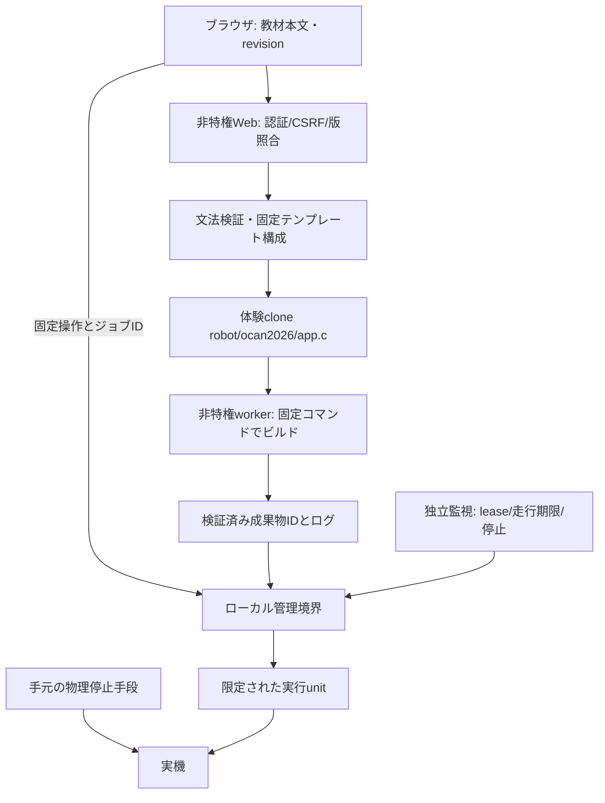

# 中学生向けWeb編集の技術検討

本書は未実装の提案。現状のダッシュボードは保存・編集APIを持たない。[現状](current-state.md)・[全体提案](development-workflow-proposal.md)と併読する。

## 1. 判断と比較

**40分の体験には制限Webエディタを条件付きで推奨する。** 標準的なC全体を自由編集させる方式は採用しない。初期試作はテキスト欄・行番号・保存/ビルド/実行/停止・コンパイルエラー表示でよい。高度な補完IDEを導入する必要はない。通常開発は従来のRemote SSHを維持する。

| 方式 | 準備・学習負担 | 編集の自由度・復旧 | 今回の位置付け |
| --- | --- | --- | --- |
| SSH＋VS Code Remote SSH | 拡張と接続設定、SSH認証が必要 | 複数ファイル・Gitに適する。SSH断時は保存状態/実行状態を再確認 | 教員・学生の標準 |
| SSH＋nano等 | 準備小、コマンド/保存操作を覚える必要 | 全ファイルへ触れられ、範囲制限が難しい | 教員の復旧用、学生の代替 |
| 簡易Webエディタ | URLだけで接続。Piへの保存ACKとログが必要 | 固定範囲、テンプレート復元、版競合のUIを作れる | 中学生の推奨試作 |
| code-server等の汎用Web IDE | 導入・資源・認証管理が増える | ターミナルや拡張まで公開しやすい | 40分用途には過大 |
| 選択式ブロック/パラメータ | 誤入力が少なく最も制限しやすい | Cを直接書く学習から離れる | 安全条件未達時の代替、救済課題 |

## 2. 保存場所・編集契約

教員が用意した体験専用cloneの`robot/ocan2026/app.c`を唯一の体験用保存先にする。配布用main checkoutは読取り専用。ブラウザからファイル名・パスを指定させず、固定教材ID`ocan2026`と本文だけを受け付ける。サーバーでパスを固定し、シンボリックリンクやパストラバーサルを拒否する。

`tracer_task()`本文のうち学習領域だけを公開し、署名・初期化・周期設定・必須`ext_tsk()`は教員管理のテンプレートから構成する。単に波括弧の個数を数えて元ファイルを書き換える実装にはしない。保存する全文は固定テンプレート＋検証済み本文として再生成し、固定部分のdigestも照合する。

センサー閾値等の講師設定は読取り専用教材側。速度調整は将来、別の範囲付き数値UIで許可し、任意のヘッダ/Makefileを開放しない。現行left/rightの単独実行とsmooth_traceには[不整合D08/D09](inconsistencies.md)があるため、検証済み語彙が確定するまでは「前進→左右旋回→if→ライン」の教材を完成扱いにしない。

## 3. 任意コマンドを許さない境界

Webのシェル注入を防ぐだけでは不十分。Cは`system()`、OS API、プリプロセッサ等を使い得る。**関数本文の範囲制限や文字列の禁止語検査だけでは任意コード実行を防げない。** 現行sudo許可は固定文字列でも、生成したaspを権限付きで実行する。Web編集ユーザーを既存実行ユーザーと共有してそのまま公開しない。

初期版の学習文法は、引数なしの検証済み関数呼出し（forward/left/right/stop、必要時black/white）と`if/else`、波括弧・セミコロン・コメントに絞る。include、define、文字列、任意識別子、ポインタ、宣言、代入、ループ、任意関数呼出しは許可しない。正規表現で危険語を削る方式ではなく、小さな文法のtokenize/parseで入力全体を消費し、ASTから既定Cを生成する。許可APIの実装とテンプレートは教員管理。この制限はCの体験用部分集合であり、自由なC開発はRemote SSHへ分ける。

ビルドworkerはsudo権限・外部ネットワーク・Git資格情報を持たず、固定の信頼済みSDK/Makefileのみ参照する。Web入力をコマンド文字列や環境変数に連結せず、固定argvと内部IDを使用する。時間・ログ量・ディスク使用量を制限し、異常終了時に子プロセスも回収する。

実行側はWebが書けないroot/教員所有の固定ラッパーまたは小さなローカル管理サービスに限定する。Webは既存の広いsudo許可を継承しない。管理側がアプリID、許可された作業領域、ビルド由来、source/asp digest、現在revisionを再検証し、検証後の実行物置換も防ぐ。root側でユーザー編集可能なMakefileを実行しない。SDKがroot起動を必要とする理由・最小権限化の可否を確認し、必要なら検証済み生成コードだけを実行対象にする。この構成でもSDK/コンパイラや許可APIの欠陥を消せるわけではなく、一般の不特定利用者向けサービスとは扱わない。

## 4. 最小APIと状態遷移案

パス名は設計案。認証済みの機体所有セッションとCSRFを全変更APIで検証する。教員権限と体験者権限を分け、体験者にreboot/poweroffや別アプリ起動を許可しない。

| 操作 | 入力 | 応答・失敗 |
| --- | --- | --- |
| GET教材 | 固定教材ID | 現本文・revision・テンプレート版・編集所有状態 |
| POST保存 | 本文・expected_revision | 文法エラー400、版競合409、成功は新revision/digest |
| POSTビルド | 保存済みrevision・request_id | 受付202とjob_id。現在版と不一致なら409 |
| GETジョブ | job_id | queued/building/succeeded/failed/cancelled、上限付きログ、成果物ID |
| POST実行 | revision・成功artifact_id・request_id | 排他/版検証、明示開始。ビルド失敗・古い版なら拒否 |
| POST停止 | 機体ID（固定） | 管理境界に即時停止要求。停止確認が取れるまで完了扱いしない |
| POST復元 | 許可template_id・expected_revision | 現版を退避して初期版/完成版を新revisionとして保存。自動実行なし |
| POST heartbeat | 実行所有token・run_id | 走行許可期限を更新。保存やGET状態取得は更新しない |

保存→未ビルド→ビルド中→成功/失敗→実行可能→実行中→停止確認の順に区別する。エディタに未保存差分がある場合は、保存済みコードを実行することを明示するか、初期版では実行を無効にする。後者を推奨。コンパイラの全文app.c上の行番号を学習領域の行番号へ対応させ、HTMLとして実行せずテキスト表示する。

ジョブ情報・保存revision・結果はPiに永続化し、HTTP要求の寿命から切り離す。最初は一台につき一ビルドと小さなJSON状態ファイル、ログファイルでよい。request_idで再送を重複実行しない。サーバー再起動後に残る実行中ジョブは再照合し、不明なら失敗/停止未確認とする。起動処理を自動再実行しない。

## 5. 入力ミス・同時操作・復旧

| 事象 | 方針 |
| --- | --- |
| セミコロン欠落・全角記号等 | 保存前に範囲内のエラー箇所を表示。直前の保存版を維持し、自動修正で別コードにしない |
| 無限ループ | 許可文法でループ不可。入力検証を抜ける不具合も想定しビルド時間上限・実行時間上限・独立停止経路を試験 |
| 二つのブラウザ | 一台一編集所有者。二人目は読取り専用、保存はrevision CAS。上書きは409、教員の引継ぎは停止後 |
| 所有ブラウザの切断 | 保存/ビルドは継続・保持。走行lease失効で停止。所有権を他端末へ自動移譲しない |
| 再読込・保存応答喪失 | Piの保存revisionを再取得しローカル下書きと比較。再送で上書きしない。再実行は明示操作 |
| ビルド失敗 | そのrevisionは実行不可、ログ表示。前のaspを自動実行しない |
| ビルド中に停止 | 停止をビルド待ちに入れない。走行中なら即停止経路、必要ならビルド取消し |
| ディスク満杯・保存途中失敗 | atomic保存に失敗したら元版を維持、成功ACKを返さない。容量診断と講師退避手順 |
| 完成版/初期版へ戻す | 停止確認→現ソース退避→許可テンプレート復元→新revision→再ビルド。Git reset --hardはWebから行わない |
| Pi再起動・workerクラッシュ | 実行は復活させず状態を照合。保存版から再開。ログと退避版は容量/保存期間上限で管理 |

ブラウザ内の未保存下書きは機体ID・テンプレート版別に保持する案が有用だが、自動的にPi側保存版へ上書きしない。共有PCは体験終了時に下書き/セッションを消す。Pi側への保存ACK後にのみ「保存済み」と表示する。

## 6. 試作の成立条件

教材語彙の実装一致、許可文法の迂回拒否、WebからSDK/Makefile/任意パスを書けないこと、Webにsudoがないこと、重複実行・競合保存・古い成果物実行の拒否、接続断停止と無応答停止の実測を必須とする。ソフトウェア停止が間に合わない場合に教員が安全に止められる方法も実機で検証する。

最初はモーターを接続せず保存/ビルドとダミー実行管理を試作し、その後車輪浮上・低速・短時間で検証する。条件が成立しなければ、中学生には検証済みプログラムの選択と数値調整を提供し、Webから編集Cを実行する運用は導入しない。今回はこの試作も実装しない。
