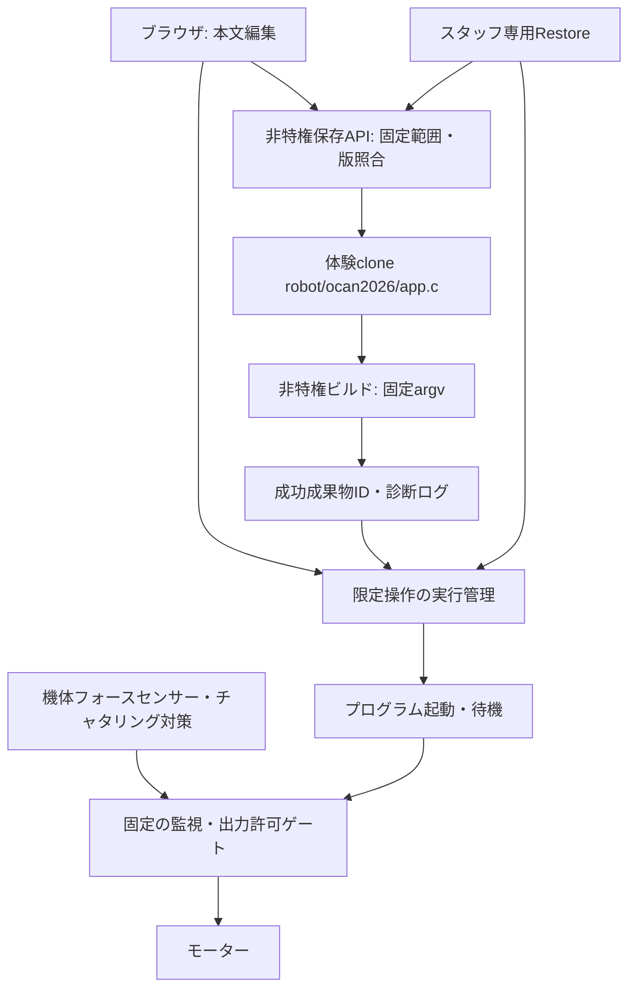

# 第2回オープンキャンパス向けWeb編集の技術検討

本書は未実装の設計案。参加者一人に学生スタッフ一人が付き、機体のすぐ横で監督する短時間体験を対象とする。一般公開の任意Cコード実行サービスにはしない。[現状](current-state.md)・[全体提案](development-workflow-proposal.md)・[移行計画](migration-plan.md)と併読する。今回の修正は設計文書のみ。

## 1. 推奨と利用範囲

**通常のC構文を使える簡易Webエディタを採用する方針とする。編集範囲は体験用ocan2026のtracer_task()本文だけとし、独自ASTパーサーによる限定文法は初期版に実装しない。** 変数宣言、演算、if/else、ループ等を独自の許可文法で排除しない。構文・型・リンクの診断は採用コンパイラに任せ、コンパイルエラーをそのまま表示する。

| 方式 | 負担と利点 | 採用場面 |
| --- | --- | --- |
| SSH＋VS Code Remote SSH | 接続設定が必要。複数ファイル・Git・デバッグ向き | 教員・学生の通常開発 |
| SSH＋ターミナルエディタ | 軽量だがコマンド・保存操作の習得が必要 | スタッフの保守・復旧、学生の代替 |
| 簡易Webエディタ | URLで接続し、保存・ビルド結果をPiから取得。SSH常時接続不要 | 第2回の40分体験 |
| 汎用Web IDE | ターミナル・拡張機能等を含め管理範囲が広がる | 初期版では導入しない |
| 完成デモ・パラメータ調整 | 編集や復旧の時間を短縮できる | 障害時・時間不足時の救済 |

監督者が入力と走行を確認することを運用上の前提にする。本文制限はCプログラムの能力を隔離するsandboxではなく、悪意あるコードを安全に実行できる保証でもない。公開ネットワークへの一般提供や監督なしの利用へ転用する場合は別途設計する。

## 2. 保存先と編集範囲

教員が用意した体験専用cloneの`robot/ocan2026/app.c`を保存先にする。体験用ブランチを選択し、配布用main checkoutをWebから書き込めなくする。Webは固定教材IDと本文・expected_revisionだけを受け付け、ファイル名、パス、Git操作、Makefile、ヘッダ、SDK、unit設定の編集APIは提供しない。

サーバーが教員管理の固定テンプレートと本文からapp.cを構成する。関数シグネチャ、初期化、ボタン監視、走行許可状態、モーター出力の停止処理は本文外の固定部分に置く。本文に必須の終了処理を参加者が記述しなくてもよいよう、周期タスクから学習関数を呼ぶ構成などを実装段階で決める。保存は本文以外の固定バイト列と他ファイルを変更しない。

本文を文字列として挿入するだけでは、余分な閉じ括弧などで関数外にコードを置ける。境界確認はサーバー側で行い、文字列・文字リテラル・コメント中の括弧を考慮する。プリプロセスによる境界への影響を含め、採用コンパイラの字句解析等を利用する方法を試作時に確定する。これは関数外への逸脱を防ぐための構造確認であり、C文法を独自の部分集合に制限するASTではない。通常のC構文や不完全な編集中コードを保存できることと両立させ、構文エラーはビルド時の診断で扱う。

固定パス・シンボリックリンク拒否・固定部分の照合はサーバーでも検査する。画面を読取り専用にするだけで範囲制限済みとは扱わない。本文外への逸脱を防げる具体方式は設計上の残課題として明示し、保存APIの受入条件にする。

## 3. 保存・ビルド・実行の権限

Webはシェルや任意コマンドの入力欄を持たず、入力をコマンド文字列に連結しない。固定argv、固定アプリID、内部job_idで保存・ビルド・実行終了を要求する。ビルドは非rootで、信頼済みSDK/Makefileを使い、時間・ログ量・保存容量に上限を設ける。C構文エラーの内容を改変・独自変換せず、stdout/stderrをHTMLとして解釈せずテキストで表示する。原文の行番号を保ち、必要なら編集領域との対応を補助表示する。

Web・保存・ビルド処理に不要な管理者権限やGitHub書込み資格情報を与えない。SDK実行に必要な権限だけを、スタッフ所有の固定実行入口に委譲する。任意unit・コマンド・make引数・作業ディレクトリをWebから指定させない。既存sudo許可を広げる前提にはしない。

一方、通常CはOS API等を呼び得るため、Webのshell=Falseだけで編集Cからの任意シェル実行まで防げるとは言えない。SDKのroot起動要件と実行Cの実効権限は要調査であり、不要な権限を落とす方法を実装前に決める。Cのsystem()等まで禁止できたとする保証は本初期版の範囲外で、スタッフ監督下の教材コードとして扱う。任意シェル実行を製品機能として公開せず、公開サービス向けsandboxの構築や限定文法への置換は初期版の必須作業にしない。

## 4. 実行と機体ボタンの必須仕様

Webの「実行」は、保存済みrevisionに対応するビルド成功プログラムを起動して**待機**にするだけ。起動時はモーター出力を停止し、押しっぱなしで起動しても走り出さない。解放確認後の新しい押下で走行を開始する。

| 現在状態 | 操作 | 次の状態 |
| --- | --- | --- |
| 終了 | Web実行 | 起動・待機（モーター停止） |
| 待機／一時停止 | 有効な機体ボタン押下 | 走行 |
| 走行 | 次の有効な機体ボタン押下 | 一時停止（モーター停止、プログラムは継続） |
| 一時停止 | 次の有効な機体ボタン押下 | 走行再開 |
| 待機／走行／一時停止 | Web「実行終了」 | モーター停止・プログラム終了 |
| 終了 | ボタン押下 | 走行しない。Webで起動後に新しい押下が必要 |

押下・解放を安定時間で判定し、押下エッジ一回につき一回だけ切り替える。長押しで連続反転させず、再解放まで次の押下を受け付けない。チャタリング判定時間・検査周期は実測で決める。Web「実行終了」と機体の「一時停止」を明確に区別し、終了要求を優先する。

開始・停止機構は中学生の本文外に置く。学習コードが返ってきた時だけ停止を判定する方式にはしない。固定の高優先度監視タスクと出力許可ゲートを候補とし、pause時は物理出力を止め、本文からの後続モーター指令で再駆動しない構成を優先する。無限ループ・長い待ち・例外的な終了で通常制御が進まない場合にもボタン監視が動くか、SDKのスケジューラとモーターAPIで実証する。

単に別タスクを作るだけで停止できるとは保証しない。通常の教材コード不具合を想定した無限ループ等を試験し、必要なら学習タスクの中断・周期起動抑止・出力層での抑止を組み合わせる。再開時は中断した学習処理の途中から続けるか次周期からやり直すかを決め、停止中の遅延指令を再生しない。割込み禁止、OS停止、ハードウェア故障までソフトウェアボタンで止められるとは扱わず、その場合の物理停止手段を実機で確認する。

## 5. 最小API・状態と同時操作

変更APIにCSRF対策と体験セッションの権限確認を適用する。初期版は一台一組、一編集所有者とし、二台目は読取り専用。保存にrevision照合を使い、競合は409で返す。スタッフ専用操作は画面の非表示だけでなくサーバーで権限確認する。

| 操作 | 入出力・契約 |
| --- | --- |
| 教材取得 | 固定教材IDの本文、revision、機体ID、現在ジョブと待機/走行/一時停止/終了状態 |
| 保存 | 本文とexpected_revision。範囲・版・容量検査、一時ファイル→rename後に新revisionを応答。C構文エラーだけを理由に保存拒否しない |
| ビルド | 保存済みrevisionを固定して一ジョブ。job_idとコンパイラ原文ログを返す。失敗時は実行不可 |
| 実行 | 成功artifact_idとrevisionを照合し起動・待機。保存後に未ビルドなら拒否。重複要求で二重起動しない |
| 実行終了 | ビルドや実行ロックの待機列に入れず終了要求。プロセス終了と実モーター停止を区別 |
| Restore（スタッフのみ） | 下記手順で実行終了→初期コード復元。体験者には許可しない |

保存・ビルドは実行終了後に行う初期UIとし、走行中の上書きやビルドは許可しない。状態表示はプロセスの生存と機体の走行状態を分け、不明な状態を「停止済み」と表示しない。保存revision、job結果、ログをPiに残し、HTTP接続の寿命から切り離す。request_idで二重要求を抑止し、サーバー再起動時には状態を照合する。

## 6. 通信断・失敗時の動作

**PC・ブラウザとPi間の通信断ではロボットを自動停止させない。ブラウザのHeartbeatやlease失効を走行停止条件にしない。一度正常に起動したプログラムはブラウザを閉じても独立して動作する。** 機体ボタンの停止は通信状態と独立して必ず機能することを受入条件とし、横のスタッフが必要に応じて一時停止する。切断検出で停止が保証されるという画面表示・手順にはしない。

| 事象 | 初期版の扱い |
| --- | --- |
| 保存前・ACK前の切断 | Piへの保存成否は未確定。再接続してrevisionと本文を比較。未保存下書きを自動上書きしない |
| 保存ACK後・ビルド中の切断 | Piの保存版とジョブは保持・継続。再接続して結果を取得。SSH常時接続不要 |
| 待機中・一時停止中の切断 | プログラムはその状態を保つ。ボタン操作は可能。再接続自体では走行開始しない |
| 走行中の切断・タブ閉じ・PCスリープ | 走行を継続する。必要に応じてスタッフが機体ボタンで止める。Web実行終了は接続回復後に使用 |
| Web再起動・再読込 | 実行プロセスはWeb接続と独立。状態再取得のみ。実行/走行再開要求を自動再送しない |
| Pi再起動・実行プロセス異常終了 | 自動走行しない構成。実モーター停止・起動時停止は実機検証が必要 |
| 構文ミス・ビルド失敗 | 原文診断を表示して修正。古いaspを代わりに起動しない |
| 無限ループ・制御コード不調 | ネットワーク経由の停止に依存せず機体ボタンで停止。停止応答と再駆動抑止を実測 |

ブラウザは編集・ビルド・実行指示・状態確認のUIであり、常時接続を走行条件にしない。PC側映像がフリーズしても機体が正常追従した事例は利用者からの運用報告として扱い、Pi内部の更新停止を示す証拠とはしない。

Pi内部のカメラ画像・制御指令更新停止、Python–Cの制御TCP断での安全停止は維持する要件とする。既存の通信失敗時stop等を削除・弱体化しない。ただし静的調査ではCの受信期限や画像鮮度による失効に未確認/不足箇所があり、全ケースの停止が実装済みとは断定しない。内部更新停止・無応答を別途検証し、不足があれば別実装PRで補う。ブラウザHeartbeatをこの内部監視の代用にしない。ocan2026のセンサー課題はカメラ/Pythonを必要としないので、利用しない制御系の監視を走行条件に追加しない。

## 7. スタッフ専用Restore

1. スタッフ権限と現在revisionを確認し、保存・ビルド・実行要求を止める。
2. 実行中ならモーター停止とプログラム終了を行い、終了を確認する。失敗・状態不明なら復元を進めず、スタッフが機体と物理停止手段で確認する。
3. 必要なら現コードを退避し、教員管理の初期テンプレートから体験用本文だけを復元する。固定部分、他ファイル、配布版mainには書き込まない。
4. 新revisionにして以前の成果物との対応を無効化する。ビルド中ジョブが残った場合も古い結果を起動対象に戻さない。
5. 必要に応じてスタッフが再ビルドする。Restore自体では起動・走行しない。次のWeb実行も待機止まりで、新しい機体ボタン押下が必要。

初期版のRestore対象は「初期状態」とする。完成版の配布はスタッフの救済手順として別途用意し、自動走行と結び付けない。Webからgit reset --hardやmain切替を実行しない。保存失敗やディスク満杯時は成功表示せず、退避と元版を維持する。

## 8. 設計上の残課題

優先順は、機体ボタン監視と出力ゲートのSDK上の成立、チャタリング値と停止距離、制御異常時の停止/再開、物理停止手段、通常Cを保った本文境界の検査方法、SDK実行時の最小権限、Restoreの終了確認方法である。次に多台数APでの切断率・回復時間を測り、有線またはHDMI＋ローカル画面/キーボードへの退避手順を決める。

これらを検証してから監督付きの少数台リハーサルへ進む。一般公開用sandbox、独自限定文法AST、ブラウザ断の自動停止は採用せず、内部制御系の安全停止とは分離する。今回は実装・実機検証を行わない。
